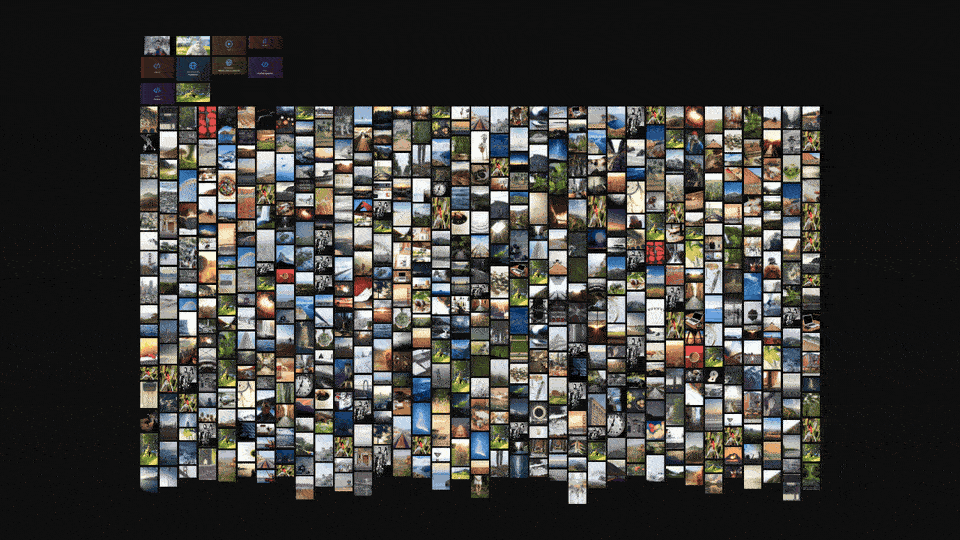

# Corkboard

[](https://www.npmjs.com/package/@niccolofanton/corkboard)
[](https://github.com/niccolofanton/corkboard/actions/workflows/ci.yml)
[](LICENSE)



Corkboard is a framework-agnostic TypeScript library that puts an infinite WebGL canvas of image, video and embed cards on screen, built on Pixi v8 and extracted from a moodboard app. It is meant for large boards on an ordinary laptop, so most of the work is in not doing work: the render loop is on demand and sits at 0 requestAnimationFrame callbacks while nothing moves, and an rbush index culls cards outside the view.

Pictures go through a level-of-detail pipeline that starts at a ThumbHash, moves to a shared atlas, and ends in per-card textures with baked rounded corners, all decoded in workers and kept under an LRU memory budget. A video card is its poster in WebGL plus a `<video>` element synced to the camera; an embed (YouTube, Vimeo, Spotify, CodePen, Figma, any page or a snippet of HTML) is a poster sprite that becomes a sandboxed iframe, laid out at a virtual 720p or 1080p screen and scaled down, as soon as it is in view (loaded a few at a time, hidden off screen, frozen to a snapshot when too small to read). Auto layout (masonry, tidy grid, align, distribute) animates cards to their new places, and dragging snaps to smart guides or to the dot grid.

**Live: [corkboard.niccolofanton.dev](https://corkboard.niccolofanton.dev)**

## Install

```sh
npm i @niccolofanton/corkboard pixi.js
```

`pixi.js` (^8.22.0) is a peer dependency: one copy, shared with your app. The package is ESM-only (`import`, no
`require`), ships its own TypeScript declarations, and is tree-shakeable (`sideEffects: false`).

Browser support: any browser with WebGL2. Snapshots of HTML embeds (see [Embeds](#embeds)) are not available in Safari,
where the frame simply stays live.

## Quick start

```ts
import { Corkboard } from '@niccolofanton/corkboard';

async function main(): Promise<void> {
  const board = await Corkboard.create(document.getElementById('board')!, { theme: 'dark' });
  board.add([
    { media: { src: 'https://picsum.photos/seed/1/480/600', aspect: 1.25 } },
    { media: { src: 'https://picsum.photos/seed/2/480/270', video: 'https://example.com/clip.mp4' } },
  ]);
  board.layout.tidy();
  board.camera.fit();
  board.on('selection', ({ ids }) => console.log(ids));
}
void main();
```

`Corkboard.create` is async (it starts the WebGL renderer). A top-level `await` works too where your build target allows it
(Vite's default target does not: set `build.target: 'es2022'`).

Pictures are read by a decode worker with `fetch`, so they need CORS headers. Videos only need to be playable by `<video>`.

## Bundlers & CSP

The decode worker is inlined in the library and started from a blob URL, so it works under any bundler or dev server (no
asset URL to resolve, no `optimizeDeps` setting). A page whose CSP has no `worker-src blob:` (or `child-src blob:` /
`script-src blob:` as the fallback) can serve the worker itself instead: the package exports it as
`@niccolofanton/corkboard/decode.worker.js`. Pass its URL as `textures.workerUrl`:

```ts
import workerUrl from '@niccolofanton/corkboard/decode.worker.js?url'; // Vite (types from vite/client); any bundler that gives you the file's URL
await Corkboard.create(el, { textures: { workerUrl } });
```

For a CSP without `unsafe-eval`, also pass `cspSafe: true` (Pixi's `unsafe-eval` build).

## API

- `Corkboard.create(host, options)`: `theme`, `grid`, `snapping`, `interaction`, `video`, `embeds`, `textures`, `overlays`, `camera`, `cspSafe`.
- Cards: `add(init | init[])`, `update(id, patch)`, `remove(ids)`, `clear()`, `get(id)`, `all()`, `size`, `inRect(rect)`, `bounds(ids?)`.
- Selection: `selection`, `select(ids)`, `selectAll()`, `clearSelection()`.
- `board.layout`: `tidy(ids?, opts)`, `masonry(ids?, opts)`, `align(mode, ids?)`, `distribute(axis, ids?)`, `equalWidth(ids?)`.
- `board.camera`: `get()`, `set(cam)`, `fit(ids?)`, `zoomTo(rect)`, `zoomBy(k)`, `actual()`, `center(x, y, scale?)`, `visible()`, `screenToWorld`, `worldToScreen`.
- Settings: `setTheme`, `setGrid`, `setSnapping({ guides, grid })`, `setVideo({ mode: 'always' | 'hover' | 'off', loop, muted, minPlayPx, maxPlaying, maxPlayingTouch })`, `setVideoPaused`, `setEmbeds({ maxLive, maxLiveTouch, maxMounted, maxOffscreen, cullMargin, minLivePx, minLiveScale, maxLoading, freezePx, maxAnimating, adaptive, resolution, arbitrarySameOrigin, autoplay, previewWorkers, previewCache })`.
- Events (`board.on(type, fn)` returns an unsubscribe): `selection`, `hover`, `click`, `dblclick`, `transform`, `gesture`, `delete`, `change`, `camera`, `cameraSettled`, `embedInteract`, `embedLive`, `embedResolved`.
- `stats()`, `dispose()`. The pure layout and snapping functions, `Store`, `Stage` and `Interaction` are exported too.

- `textures`: `budgetBytes`, `workers`, `workerUrl`, `uploadBudgetMs`, `overscan`, `softCanvas`.
- `camera`: `minScale`, `maxScale` (default 0.05..4). A board much wider than the screen that must fit whole needs a lower minimum.
- `interaction`: `select`, `emptyDrag`, `keyboard`, `commit`, and for a host that draws its own chrome `marquee: false` (a drag
  on empty canvas always pans), `keepSelectionOnPan` (a pan keeps the selection, a click that does not move clears it) and
  `selectionOutline: false` (the canvas draws no selection outline or handles). `board.interaction.setPanMode(true)` is a hand
  tool: a left-button drag pans from anywhere, over a card included, like holding Space.
- `video` (`mode: 'always'`): a card plays on its own only if its long side is at least `minPlayPx` CSS px on screen
  (default 160), and at most `maxPlaying` play at once (default 8; `maxPlayingTouch`, default 2, on touch), the biggest and
  most central first. Smaller or surplus cards stay a thumbnail, so a zoomed-out board opens no streams. The pool shares the
  frame budget of the embeds: a slow window (under 40 fps) cuts the cap to 60% of what plays (at least 1, the most visible
  clips keep playing) and two smooth ones in a row give 50% back, up to `maxPlaying`. `board.videoBudget` is the cap now.
- `camera.fit()` on a host that has no size yet (hidden tab, pane not laid out) waits for the first real size and then
  centres, unless the camera was moved meanwhile.
- Keyboard shortcuts act only while the board itself has focus, never for keys typed in an `<input>` inside the host.

A card is `{ media: { src, video?, sizes?, aspect?, thumbhash?, color? }, x?, y?, w?, h?, rot?, radius?, locked?, aspectLocked?, data? }`.
Cards with no `x` / `y` are placed on a free spot near what is on screen (a given `x` or `y` alone is kept, and an embed
without `w` is 400 wide).

## Embeds

```ts
const board = await Corkboard.create(el, {
  embeds: { maxLive: 12, resolve: async (url) => (await fetch(`/api/embed?url=${url}`)).json() },
});
board.add({ media: { embed: { url: 'https://youtu.be/dQw4w9WgXcQ' } } });          // nothing else to set up
board.add({ media: { embed: { url: 'https://example.com/post', title: 'A post' }, aspect: 0.75 } });
board.add({ media: { embed: { html: '<button onclick="this.textContent=1">0</button>' } } }); // a snippet
```

- `media.embed` is `{ url }` or `{ html }` (+ `title`). `media.aspect` is height / width, as everywhere; a known provider has its own.
  `media.src` is the poster: leave it out and the board resolves one (the card is a textured sprite like any other).
  What the board generates (tile, fetched thumbnail, snapshot, preview) is a runtime picture on the stage
  (`stage.setPosterOverride`), never written to your store: no `change` event, nothing dead to save, and swapping one poster
  for another keeps the old one on screen until the new one has decoded (no flash of the placeholder).
- Poster, first hit wins: your `src`; `embeds.resolve(url)` (`{ poster?, iframeSrc?, aspect?, title?, frameable? }`); YouTube
  thumbnails; a generated tile (host, title, glyph, themed). oEmbed titles / thumbnails, `og:image`, screenshots and
  `X-Frame-Options` probing need a server: do them behind `resolve` and cache the result. `frameable: false` makes a bookmark
  card (never live, a double-click opens the URL in a new tab).
- Live iframe: any card in view (`minLivePx` and `minLiveScale` are opt-in floors, 0 by default) or selected, camera still, at
  most `maxLive` at once (12, or 3 on touch), the biggest on screen first. Frames mount in chunks (`maxLoading`, default 6, at a
  time, nearest the centre first). It is laid out at world size and moved with the camera as one CSS matrix. A frame that stops
  qualifying is parked (inert, still showing its last frame) rather than destroyed; `maxMounted` frames (24, or 6 on touch) stay
  in all, and the least valuable parked ones are destroyed past that.
- Culling: a mounted iframe whose card leaves the view (plus a `cullMargin` of 50 % of the viewport on each side) is hidden at
  once (`display: none`, so it stops rendering but keeps its state) and shows again the moment the card returns. A loaded
  snippet is snapshotted on the way out so its last frame is the poster. At most `maxOffscreen` hidden frames are kept (64, or
  12 on touch), the most recently seen first; the rest are destroyed when the camera settles.
- Freezing: a mounted frame whose card gets smaller than `freezePx` on screen (default 140 CSS px, short side; 0 turns it
  off; raised up to 4x while the page stays slow with the animating budget at its floor, `board.embeds.freezeThreshold`) and is not selected or in interact mode stops costing anything. A snippet is asked (by a small script injected ahead
  of its HTML) for a snapshot of its own document, current animation state included; that image becomes the card's poster
  and the frame is hidden (`display: none`, alive, so it resumes where it was). A YouTube or Vimeo player is paused through
  its postMessage API (it keeps showing the current video frame) and played again afterwards. Both come back above 1.4x
  `freezePx`, when selected, or on interact. Parked and culled snippets are paused (animations and `requestAnimationFrame`),
  parked and culled videos too. A snapshot that fails (a tainted canvas, Safari) leaves the frame live. `board.embeds.frozen`.
- Animating budget: of the mounted frames that are on screen, not parked, culled or frozen, the ones that can be paused
  (snippets, YouTube / Vimeo players that may be playing) are ranked (interacting, selected, biggest on screen, nearest the
  centre) and only the first N animate; the rest are paused and keep showing their last frame. Mounting is not affected.
  `maxAnimating` is the ceiling (default `Infinity`); with `adaptive` (default `true`) the board's frame-rate monitor lowers N
  to 70% of what animates (min 6) after a second under 40 fps and raises it by a quarter + 2 after two seconds in a row over
  55 fps, up to the ceiling. The monitor does not run a rAF loop all the time: it samples in short bursts (4 one-second
  windows at most, or until two in a row agree) started by anything that can change the load (camera settled, frames mounted,
  destroyed, frozen or thawed, a budget moved) and by a 10 s heartbeat while something renders in a visible tab, then stops so
  the page can idle. Pages that cannot be paused (plain URLs, Spotify, CodePen, Figma) take no slot. `board.embeds.animating`,
  `board.embeds.animatingBudget`.
- Previews: an HTML snippet card that has not been live shows a generated tile until `embeds.previewWorkers` hidden frames
  (default 3, 0 turns it off) render it in the background (nearest the view first, camera still, 400 ms in) and its poster
  becomes a real picture of the snippet. They take no live or loading slot. Pictures are cached by a hash of the snippet,
  in memory and, with `embeds.previewCache: 'persistent'` (opt-in, default `'memory'`: it leaves pictures of the snippets on the
  visitor's disk), in Cache Storage (at most 1000, the oldest dropped first) so a reload shows them at once.
  `board.embeds.previewsPending`.
- Resolution: a live page is laid out at a virtual screen with the card's aspect, then scaled onto the card, so it shows
  its desktop layout at any card size. `embeds.resolution` is `'720p'` (default: short side 720 CSS px, a 16:9 card is a
  1280 x 720 page), `'1080p'` (1920 x 1080), a number (the short side) or `'native'` (the card's world size: a 400 px card
  is a 400 px wide page). `media.embed.resolution` overrides it per card; `setEmbeds({ resolution })` changes it live.
- It does not take pointer events: pan, zoom, select and drag work over it. Double-click (or Enter on a selected card) enters
  interact mode; Done, Esc or a click outside ends it (`embedInteract`). Keys and wheel inside a cross-origin frame never reach
  the page.
- Sandbox, computed at render time and never stored: allowlisted providers get `allow-scripts allow-same-origin allow-forms
  allow-popups allow-presentation`; other URLs the same minus `allow-presentation`; snippets run in `srcdoc` with `allow-scripts`
  only plus a CSP (no network). Only http(s) URLs load. A snippet has no storage and cannot reach the page.
  The allowlist is the exact embed URLs the built-in parsers emit (`youtube-nocookie.com/embed/`, `player.vimeo.com/video/`,
  `open.spotify.com/embed/`, `codepen.io/<user>/embed/`, `figma.com/embed`), not whole hosts.
- Arbitrary URLs keep `allow-same-origin` because many sites break without their own cookies and storage. The risk: the
  sandbox flags survive navigation inside the frame, so a link followed in interact mode loads the next site with scripts
  and its real origin (it still cannot reach your page; a frame on your own origin never gets the flag). To give those frames
  an opaque origin instead, pass `embeds: { arbitrarySameOrigin: false }` (also `setEmbeds`).
- A `blob:` `media.src` on an embed card (an old saved board) is treated as absent, since it died with its page: a fresh poster
  is made for it and `embedResolved.poster` never reports a blob. A host's https / data: `media.src` stays the poster of a
  tile or fetched thumbnail; a snapshot or preview of a snippet, which is the real picture, goes over it. Neither is written
  to `media.src`. Persist `embedResolved.poster` (an https URL), not blobs, when you save a board.
- Live state: `board.embeds.live`, `board.embeds.interacting`, `board.embeds.interact(id)`, `board.embeds.info(id)`.

## Adding an element kind

`ElementKind` (`src/types.ts`) is a union. A new kind is one view in `src/render/views/registry.ts` and, if it needs live DOM,
one `Overlay` (`src/overlay.ts`) passed through `options.overlays`.

## Docs

- [docs/HANDOFF.md](docs/HANDOFF.md): how the renderer works (stage, culling, LOD textures, atlas, video, layout, snapping, perf budget, lessons learned).
- [docs/HTML-EMBEDS.md](docs/HTML-EMBEDS.md): research on HTML / iframe cards in a WebGL canvas and the design chosen.

## Development

```sh
pnpm install    # pnpm 10.11.1 (see packageManager); pixi.js is a devDependency here
pnpm dev        # the demo (600 cards)
pnpm test
pnpm typecheck
pnpm build      # dist/: library, bundled index.d.ts, decode.worker.js
```

## License

MIT
