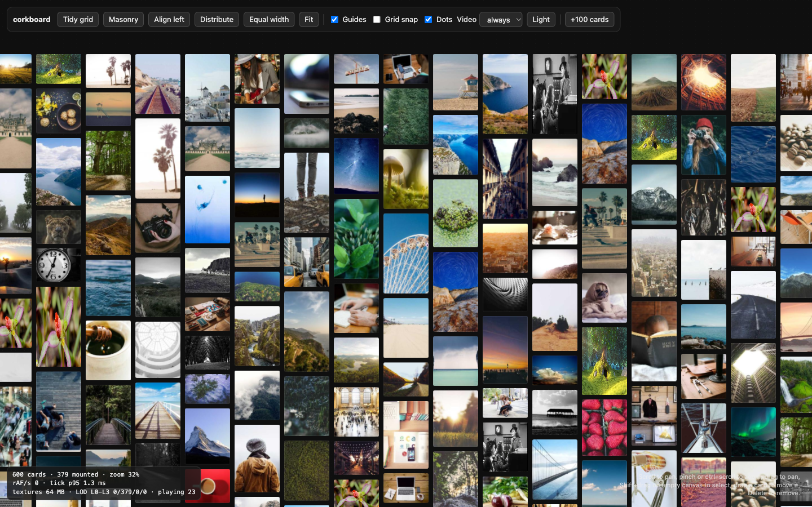

# corkboard

An infinite canvas of image, video and embed cards on WebGL (Pixi v8). Framework-agnostic TypeScript.



- Camera: wheel / trackpad pan, pinch and ctrl+wheel zoom, drag with inertia, fit, zoom to rect, animated flights.
- On-demand render loop (0 requestAnimationFrame callbacks while idle), rbush culling, LOD textures
  (ThumbHash, atlas, own textures) decoded in workers, LRU memory budget, WebGL context-loss recovery.
- `image`, `video` and `embed` cards. A video card is its poster in WebGL plus a live DOM `<video>` overlay; an embed
  (a YouTube / Vimeo / Spotify / CodePen / Figma link, any page, or a snippet of HTML) is its poster plus, only when it
  is big on screen or selected, one sandboxed `<iframe>`.
- Auto layout (masonry, tidy grid, align, distribute, equal width, auto spot) and snapping (smart guides, snap to the dot grid).
- Select, marquee, drag-move and handle-resize. No undo, no collaboration.

## Quick start

```ts
import { Corkboard } from 'corkboard';

const board = await Corkboard.create(document.getElementById('board')!, { theme: 'dark' });
board.add([
  { media: { src: 'https://picsum.photos/seed/1/480/600', aspect: 1.25 } },
  { media: { src: 'https://picsum.photos/seed/2/480/270', video: 'https://example.com/clip.mp4' } },
]);
board.layout.tidy();
board.camera.fit();
board.on('selection', ({ ids }) => console.log(ids));
```

Pictures are read by a decode worker with `fetch`, so they need CORS headers. Videos only need to be playable by `<video>`.

## API

- `Corkboard.create(host, options)`: `theme`, `grid`, `snapping`, `interaction`, `video`, `embeds`, `textures`, `overlays`, `cspSafe`.
- Cards: `add(init | init[])`, `update(id, patch)`, `remove(ids)`, `clear()`, `get(id)`, `all()`, `size`, `inRect(rect)`, `bounds(ids?)`.
- Selection: `selection`, `select(ids)`, `selectAll()`, `clearSelection()`.
- `board.layout`: `tidy(ids?, opts)`, `masonry(ids?, opts)`, `align(mode, ids?)`, `distribute(axis, ids?)`, `equalWidth(ids?)`.
- `board.camera`: `get()`, `set(cam)`, `fit(ids?)`, `zoomTo(rect)`, `zoomBy(k)`, `actual()`, `center(x, y, scale?)`, `visible()`, `screenToWorld`, `worldToScreen`.
- Settings: `setTheme`, `setGrid`, `setSnapping({ guides, grid })`, `setVideo({ mode: 'always' | 'hover' | 'off', loop, muted })`, `setVideoPaused`, `setEmbeds({ maxLive, maxLiveTouch, minLivePx })`.
- Events (`board.on(type, fn)` returns an unsubscribe): `selection`, `hover`, `click`, `dblclick`, `transform`, `gesture`, `delete`, `change`, `camera`, `cameraSettled`, `embedInteract`, `embedLive`, `embedResolved`.
- `stats()`, `dispose()`. The pure layout and snapping functions, `Store`, `Stage` and `Interaction` are exported too.

A card is `{ media: { src, video?, sizes?, aspect?, thumbhash?, color? }, x?, y?, w?, h?, rot?, radius?, locked?, aspectLocked?, data? }`.
Cards with no `x` / `y` are placed on a free spot near what is on screen.

## Embeds

```ts
const board = await Corkboard.create(el, {
  embeds: { maxLive: 4, minLivePx: 320, resolve: async (url) => (await fetch(`/api/embed?url=${url}`)).json() },
});
board.add({ media: { embed: { url: 'https://youtu.be/dQw4w9WgXcQ' } } });          // nothing else to set up
board.add({ media: { embed: { url: 'https://example.com/post', title: 'A post' }, aspect: 0.75 } });
board.add({ media: { embed: { html: '<button onclick="this.textContent=1">0</button>' } } }); // a snippet
```

- `media.embed` is `{ url }` or `{ html }` (+ `title`). `media.aspect` is height / width, as everywhere; a known provider has its own.
  `media.src` is the poster: leave it out and the board resolves one (the card is a textured sprite like any other).
- Poster, first hit wins: your `src`; `embeds.resolve(url)` (`{ poster?, iframeSrc?, aspect?, title?, frameable? }`); YouTube
  thumbnails; a generated tile (host, title, glyph, themed). oEmbed titles / thumbnails, `og:image`, screenshots and
  `X-Frame-Options` probing need a server: do them behind `resolve` and cache the result. `frameable: false` makes a bookmark
  card (never live, a double-click opens the URL in a new tab).
- Live iframe: only for a card at least 320 x 200 px on screen (`minLivePx`) or selected, zoom >= 25 %, camera still, at most
  `maxLive` at once (4, or 1 on touch). It is laid out at world size and moved with the camera as one CSS matrix; leaving the
  live state destroys it (LRU by last selection).
- It does not take pointer events: pan, zoom, select and drag work over it. Double-click (or Enter on a selected card) enters
  interact mode; Done, Esc or a click outside ends it (`embedInteract`). Keys and wheel inside a cross-origin frame never reach
  the page.
- Sandbox, computed at render time and never stored: allowlisted providers get `allow-scripts allow-same-origin allow-forms
  allow-popups allow-presentation`; other URLs the same minus `allow-presentation`; snippets run in `srcdoc` with `allow-scripts`
  only plus a CSP (no network). Only http(s) URLs load. A snippet has no storage and cannot reach the page.
- Live state: `board.embeds.live`, `board.embeds.interacting`, `board.embeds.interact(id)`, `board.embeds.info(id)`.

## Adding an element kind

`ElementKind` (`src/types.ts`) is a union. A new kind is one view in `src/render/views/registry.ts` and, if it needs live DOM,
one `Overlay` (`src/overlay.ts`) passed through `options.overlays`.

## Docs

- [docs/HANDOFF.md](docs/HANDOFF.md): how the renderer works (stage, culling, LOD textures, atlas, video, layout, snapping, perf budget, lessons learned).
- [docs/HTML-EMBEDS.md](docs/HTML-EMBEDS.md): research on HTML / iframe cards in a WebGL canvas and the design chosen.

## Development

```sh
pnpm install
pnpm dev        # the demo (600 cards)
pnpm test
pnpm typecheck
pnpm build      # dist/ with .d.ts
```

## License

MIT
